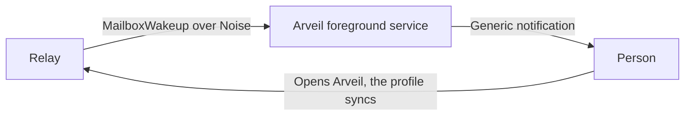

# Opening attachments and receiving notifications

**Source increment, September 30, 2026; not yet a published client release.**
Tracked in [issue 140](https://github.com/Ulzuhan/arveil/issues/140).
Notices on Android and macOS come from your own relay, without Google/FCM or a second app ([ADR-014](adr/ADR-014-relay-activity-notices.md)).

*Versión en español: [es/CLIENT_FILES_NOTIFICATIONS.md](es/CLIENT_FILES_NOTIFICATIONS.md)*

## Open a file from the conversation

Choose **Download and open** on an incoming attachment, or **Open** on a file
already available locally. PNG, JPEG and WebP images open inside Arveil with
zoom. Opening an already available file works offline. **Save copy…** remains a
separate export action; previewing does not add a file to Downloads or Photos.

The viewer gets authenticated bytes from Rust's existing `exportAttachment`
API, which checks availability, decryption and integrity. Despite its name,
that API returns bytes and does not write an exported file. The image decoder
uses content signatures, owns and disposes its image, and avoids Flutter's shared
image cache. Encoded size stays under the attachment limit; decoded source
dimensions are limited to 16,384 per side and 64 million pixels, with the display
image scaled to at most 4,096 per side and 4 million pixels. Only the first frame
is displayed. HTML/SVG are not rendered as web content.

PDF and other formats currently use **Open with…**, following an explicit
confirmation that another application receives decrypted bytes. Android uses a
`FileProvider` scoped to `cache/attachment-open`, a content URI and temporary
read permission. macOS opens a private temporary file through `NSWorkspace`.
Each opening gets its own random directory. Copies expire after one hour, with
cleanup every 30 seconds while running and on the next launch after expiry.
Android revokes URI grants during cleanup; Mac directories/files use 0700/0600
and are excluded from backup. External applications can retain their own copies;
cleanup cannot erase those copies or promise secure deletion.

An internal PDF renderer remains a separate increment. It must be reviewed for
plaintext staging, resource limits and renderer isolation before adoption.

## macOS notifications and background operation

**Settings → Notifications** offers two independent, off-by-default options:

- **Show notifications on this Mac** requests the system's alert/sound permission.
  Notices are generic; no name, message text, filename or conversation identifier
  is passed to the operating system.
- **Keep Arveil running in the background** keeps the profile unlocked and waits
  for the relay's activity notices on the profile's own session, syncing when one
  arrives (ADR-014). While subscribed it also syncs every two minutes; while the
  session is down it falls back to every ten seconds. Closing the window hides it;
  the menu-bar item can reopen Arveil or quit it. Closing the profile removes the
  background menu and notices.

The same Rust profile and conversation coordinator own synchronization and read
state. Window focus, route visibility and sync eligibility are separate: hidden
activity is not marked read. New unread activity in the visible conversation is
silent; own activity, unchanged snapshots and the initial history snapshot are
also silent. Several new conversations in one snapshot produce one generic
notice. A tap selects a known conversation; a token no longer known opens the inbox.

Presentation receipts are SHA-256 hashes of a group/cursor pair, bounded to 512
entries in the nonsynchronizing login Keychain. They contain no previews or
read markers. A receipt is saved before presenting, so a crash in that interval
can miss a banner; it cannot change unread messages. The mapping from notice
tokens to conversations exists only in memory.

Explicit Quit, a closed profile or a sleeping Mac stops this local delivery.
macOS Focus/notification settings can silence it. Opening/waking catches up
through normal sync. This does not provide delivery into a terminated process
or use APNs. Packaged-app permission, menu/window behavior, click handling and
sleep/wake delivery still require interactive acceptance before a release promise.

## Android: notices from your own server

**Settings → Notifications → Receive activity notices** turns them on. Arveil
registers a watch key for this device with the relay through the open profile,
hands the credentials to its own foreground service and asks for Android's
notification permission. There is no second app, no server address to type and
no Google service.

- **What runs.** A `specialUse` foreground service keeps one watch session to the
  relay ([ADR-014](adr/ADR-014-relay-activity-notices.md)). It tries the signed
  endpoint list in order, reconnects after a failure with a pause of 1 s doubling
  to 60 s, and at once when the network changes. It pings every 90 seconds.
  Android shows a permanent, silent "Waiting for activity" notification while it
  runs; that channel can be silenced. It starts again after a reboot or an update.
- **What a notice says.** Only "Activity pending. Open Arveil to check your
  messages." The service never opens the profile, decrypts or reads anything,
  and the relay's notice names nothing. Notices coalesce until a successful sync
  in the foreground; one received while Arveil is visible is shown once if Arveil
  leaves before syncing. A tap opens the inbox after unlocking.
- **What the key can do.** Only wait for notices: the relay refuses every other
  frame from it. The credentials are encrypted under an Android Keystore key and
  stay out of backups. A rotated, revoked or removed key ends the service; Arveil
  registers a new one the next time it opens.
- **Turning off** stops the service and the notices at once and removes the key
  from the relay. If the relay cannot be reached, the removal is retried while
  Arveil is open. Opening another identity on the phone clears the previous one's
  notices.
- **Battery.** Android may pause Arveil; **Allow in background** opens the system
  exemption. Force stop ends notices until Arveil is opened again.
- **What it costs.** While notices are on, the relay and any carrier in between see
  when this phone is connected and from which network
  ([what each party learns](adr/ADR-014-relay-activity-notices.md#what-each-party-learns)).
- **Upgrading from betas 5 and 6.** Their ntfy/UnifiedPush receiver is gone. On
  first start Arveil removes the ntfy endpoint from the relay and, if notices were
  on, turns the new ones on. The ntfy app is no longer needed.

### Remaining work

- Physical phone: screen off and Doze, battery saver, Wi-Fi to mobile data and
  back, reboot, process death, removal from Recents, force stop and reopening.
  Measure delay and battery over LAN or tailnet and over the public tunnel. A
  server cannot bypass [Android's background limits](https://developer.android.com/training/monitoring-device-state/doze-standby).
- The 90-second keepalive is fixed; measure it per route and adjust
  ([ADR-014, open questions](adr/ADR-014-relay-activity-notices.md#open-questions)).
- The relay still accepts the old `NotifyHintSet` for clients that have not
  updated; it goes one release later ([ADR-014 §5](adr/ADR-014-relay-activity-notices.md#5-ntfy-and-the-m34-hint-are-retired)).

## Evidence and limits

The implementation passes Flutter analysis and 321 unit/widget tests, including
preview bounds, external-sharing confirmation, failed verification, notification
deduplication, permission denial and hidden read-marker protection. Debug builds
passed on macOS and Android. Disposable native macOS acceptance checks encrypted
transfer/reopen, offline sent/received image preview, cancellation, duplicate
filenames and the explicit export boundary.

Android, 2026-10-16, on an Android 15 ARM64 emulator against a disposable
relay (`scripts/test_android_watch.py`): the debug service subscribed through
JNI within a second, showed its persistent notification, showed only the generic
notice when another identity wrote, and stopped with the key refused once it was
removed. The application-level relay test
`activity_notices_reach_a_watch_key_and_an_open_profile` checks a registered watch
key, the open profile's member session and the refusal of a removed key. Six Dart
tests cover enabling, offline disabling and its retry, migration from the ntfy
hint, renewing a refused key once per foreground, and foreground-only sync. None
of this establishes physical-phone behavior under Doze, battery limits or network
changes.

Betas 5 and 6 used a self-hosted ntfy server and its F-Droid app through
UnifiedPush. That design, its acceptance and its limits are in this document's
history before ADR-014; the relay's M3.4 hint it relied on still works for those
clients until they update.

Separate macOS native acceptance passed window hiding/reopening, real external
text-file opening, 0700/0600 temporary permissions and expiry cleanup. With Arveil's
notification permission enabled in macOS settings, notification-center delivery
and removal on profile close also pass. The test reopens the window before
closing the profile, so removing the last background keep-alive does not terminate
the acceptance process. Packaged permissions, visible banners, taps, sleep/wake
and physical Android are still release gates.
Contact testing is deferred to the next iteration.
