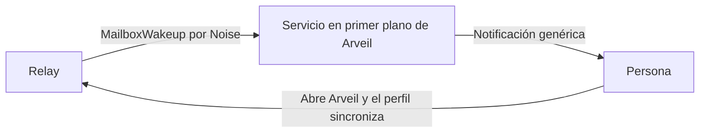

# Abrir adjuntos y recibir notificaciones

**Incremento en código del 30 de septiembre de 2026; aún sin publicar.**
Seguimiento en [issue 140](https://github.com/Ulzuhan/arveil/issues/140).
Los avisos en Android y macOS llegan de tu propio relay, sin Google/FCM ni una segunda app ([ADR-014](adr/ADR-014-relay-activity-notices.md)).

*English version: [../CLIENT_FILES_NOTIFICATIONS.md](../CLIENT_FILES_NOTIFICATIONS.md)*

## Abrir un archivo desde la conversación

Pulsa **Descargar y abrir** en un adjunto recibido o **Abrir** si ya está disponible.
Las imágenes PNG, JPEG y WebP se ven dentro de Arveil con zoom, también sin conexión.
**Guardar copia…** sigue siendo una exportación independiente; previsualizar no
añade archivos a Downloads ni a Fotos.

El visor recibe bytes autenticados mediante la API Rust `exportAttachment`, que
comprueba disponibilidad, descifrado e integridad. Aunque se llame así, devuelve
bytes y no escribe una copia exportada. El decodificador reconoce firmas del
contenido, controla y libera su imagen y evita la caché compartida de Flutter.
El archivo mantiene el límite de adjuntos; la imagen original admite como máximo
16.384 píxeles por lado y 64 millones en total. La visualización se reduce a un
máximo de 4.096 por lado y 4 millones en total. Solo se muestra el primer fotograma.
No se renderiza HTML/SVG como contenido web.

Los PDF y demás formatos usan por ahora **Abrir con…**, tras confirmar que otra
aplicación recibirá bytes descifrados. Android utiliza un `FileProvider` limitado
a `cache/attachment-open`, una URI de contenido y permiso temporal de lectura.
macOS abre un archivo temporal privado mediante `NSWorkspace`. Cada apertura
tiene un directorio aleatorio independiente. Las copias caducan a la hora y se
limpian cada 30 segundos mientras Arveil se ejecuta, o al siguiente arranque si
ya caducaron. Android revoca los permisos URI; Mac usa directorios/archivos
0700/0600 excluidos de las copias de seguridad. La aplicación externa puede
conservar copias propias; esta limpieza no las elimina ni garantiza borrado seguro.

El visor PDF interno queda para otro incremento: antes hay que revisar sus
temporales descifrados, límites de recursos y aislamiento.

## Notificaciones y segundo plano en macOS

**Ajustes → Notificaciones** ofrece dos opciones independientes, desactivadas
inicialmente:

- **Mostrar notificaciones en este Mac** solicita permiso de avisos/sonido al
  sistema. El aviso es genérico: no entrega al sistema nombres, contenido,
  nombres de archivo ni identificadores de conversación.
- **Mantener Arveil en segundo plano** mantiene el perfil desbloqueado y espera los
  avisos de actividad del relay en la propia sesión del perfil, y sincroniza cuando
  llega uno (ADR-014). Mientras está suscrito sincroniza además cada dos minutos;
  si la sesión se cae, vuelve a hacerlo cada diez segundos. Cerrar la ventana la
  oculta; el icono de la barra de menús permite abrir Arveil o salir. Cerrar el
  perfil retira ese menú y los avisos.

El mismo perfil Rust y coordinador de conversaciones controlan sincronización
y lecturas. El foco de la ventana, la pantalla visible y la posibilidad de
sincronizar son estados distintos: un mensaje oculto no se marca leído.
La conversación visible, la actividad propia, las consultas sin cambios y la
primera lectura del historial no generan avisos. Varias conversaciones nuevas
en una consulta se agrupan en un aviso genérico. Pulsarlo abre una conversación
conocida; si ya no se conoce el token, abre la bandeja.

Los comprobantes de presentación son hashes SHA-256 del par grupo/cursor,
limitados a 512 entradas en el llavero de inicio de sesión sin sincronización.
No contienen previsualizaciones ni marcas de lectura. Se guardan antes de
presentar: un cierre inesperado en ese intervalo puede perder el aviso, pero
no modifica los mensajes sin leer. La relación entre token y conversación solo
vive en memoria.

Salir de Arveil, cerrar el perfil o suspender el Mac detiene esta entrega local.
Concentración y los ajustes de macOS pueden silenciarla. Al volver se recupera
mediante sincronización normal. No entrega con el proceso terminado ni usa APNs.
Permisos con la aplicación empaquetada, menú/ventana, pulsación del aviso y
suspensión/reactivación requieren aceptación interactiva antes de prometerlos
en una versión publicada.

## Android: avisos desde tu propio servidor

**Ajustes → Notificaciones → Recibir avisos de actividad** los activa. Arveil
registra en el relay una clave de vigilancia para este dispositivo a través del
perfil abierto, entrega las credenciales a su propio servicio en primer plano y
pide el permiso de notificaciones de Android. No hay segunda app, ni dirección de
servidor que escribir, ni servicios de Google.

- **Qué se ejecuta.** Un servicio en primer plano `specialUse` mantiene una sesión
  de vigilancia con el relay ([ADR-014](adr/ADR-014-relay-activity-notices.md)).
  Prueba la lista firmada de direcciones por orden, reconecta tras un fallo con una
  pausa de 1 s que se duplica hasta 60 s, y al momento cuando cambia la red. Envía
  un ping cada 90 segundos. Android muestra una notificación permanente y silenciosa
  «Espera de avisos» mientras funciona; ese canal se puede silenciar. Vuelve a
  arrancar tras reiniciar o actualizar.
- **Qué dice un aviso.** Solo «Hay actividad pendiente. Abre Arveil para consultar
  tus mensajes.». El servicio nunca abre el perfil, no descifra ni lee nada, y el
  aviso del relay no nombra nada. Los avisos se agrupan hasta una sincronización
  correcta en primer plano; uno recibido con Arveil visible se muestra una vez si
  Arveil pasa a segundo plano antes de sincronizar. Pulsarlo abre la bandeja tras
  desbloquear.
- **Qué puede hacer la clave.** Solo esperar avisos: el relay rechaza cualquier otro
  frame suyo. Las credenciales se cifran con una clave del Keystore de Android y no
  entran en copias de seguridad. Una clave rotada, revocada o retirada detiene el
  servicio; Arveil registra otra la próxima vez que se abre.
- **Desactivar** detiene el servicio y los avisos al momento y retira la clave del
  relay. Si el relay no responde, la retirada se reintenta mientras Arveil está
  abierto. Abrir otra identidad en el móvil borra los avisos de la anterior.
- **Batería.** Android puede pausar Arveil; **Permitir en segundo plano** abre la
  exención del sistema. Forzar el cierre detiene los avisos hasta volver a abrir Arveil.
- **Qué cuesta.** Mientras los avisos están activos, el relay y cualquier ruta
  intermedia ven cuándo está conectado este móvil y desde qué red
  ([qué sabe cada parte](adr/ADR-014-relay-activity-notices.md)).
- **Al actualizar desde las betas 5 y 6.** Su receptor ntfy/UnifiedPush desaparece.
  En el primer arranque Arveil retira del relay el endpoint de ntfy y, si los avisos
  estaban activos, activa los nuevos. La app ntfy ya no hace falta.

### Trabajo pendiente

- Móvil físico: pantalla apagada y Doze, ahorro de batería, cambio de Wi-Fi a datos
  y vuelta, reinicio, muerte del proceso, retirada de Recientes, forzar cierre y
  reabrir. Medir demora y batería por LAN o tailnet y por el túnel público. Un
  servidor no puede saltarse las
  [restricciones de Android](https://developer.android.com/training/monitoring-device-state/doze-standby).
- El ping de 90 segundos es fijo; hay que medirlo por ruta y ajustarlo
  ([preguntas abiertas de la ADR-014](adr/ADR-014-relay-activity-notices.md)).
- El relay sigue aceptando el antiguo `NotifyHintSet` para los clientes sin
  actualizar; se retira una versión después ([ADR-014 §5](adr/ADR-014-relay-activity-notices.md)).

## Evidencia y límites

Pasan el análisis Flutter y 321 pruebas unitarias/de interfaz: límites del visor,
confirmación de apertura externa, rechazo de bytes no verificados, deduplicación,
permiso denegado y protección de lecturas ocultas. Compilan los clientes debug
Mac y Android. La aceptación nativa macOS con perfiles desechables comprueba
transferencia/reapertura cifrada, imágenes enviadas y recibidas sin conexión,
cancelación, nombres duplicados y exportación explícita.

Android, 16-10-2026, en un emulador Android 15 ARM64 contra un relay desechable
(`scripts/test_android_watch.py`): el servicio de depuración se suscribió por JNI
en menos de un segundo, mostró su notificación permanente, mostró solo el aviso
genérico cuando escribió otra identidad y se detuvo con la clave rechazada al
retirarla. La prueba con relay de la capa de aplicación
`activity_notices_reach_a_watch_key_and_an_open_profile` comprueba una clave de
vigilancia registrada, la sesión de miembro del perfil abierto y el rechazo de una
clave retirada. Seis pruebas Dart cubren activar, desactivar sin conexión y su
reintento, la migración desde el aviso ntfy, la renovación de una clave rechazada
una vez por paso a primer plano y la sincronización solo en primer plano. Nada de
esto demuestra el comportamiento en un móvil físico con Doze, límites de batería o
cambios de red.

Las betas 5 y 6 usaban un servidor ntfy propio y su app de F-Droid mediante
UnifiedPush. Ese diseño, su aceptación y sus límites están en el historial de este
documento anterior a la ADR-014; el aviso M3.4 del relay en que se apoyaba sigue
funcionando para esos clientes hasta que se actualicen.

La aceptación nativa Mac por separado pasó ocultar y reabrir la ventana, abrir
un archivo real externo, permisos temporales 0700/0600 y limpieza al caducar.
Con el permiso de Arveil activado en Ajustes de macOS, también pasan la entrega
al centro de notificaciones y su retirada al cerrar el perfil. La prueba reabre
la ventana antes de cerrar el perfil para que retirar el último motivo para seguir
en segundo plano no termine el proceso de aceptación. Permisos empaquetados,
banner visible, pulsación, suspensión/reactivación y Android físico siguen pendientes antes de
publicar. Las pruebas de contactos quedan para la siguiente iteración.
